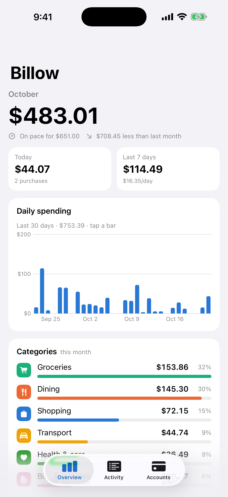
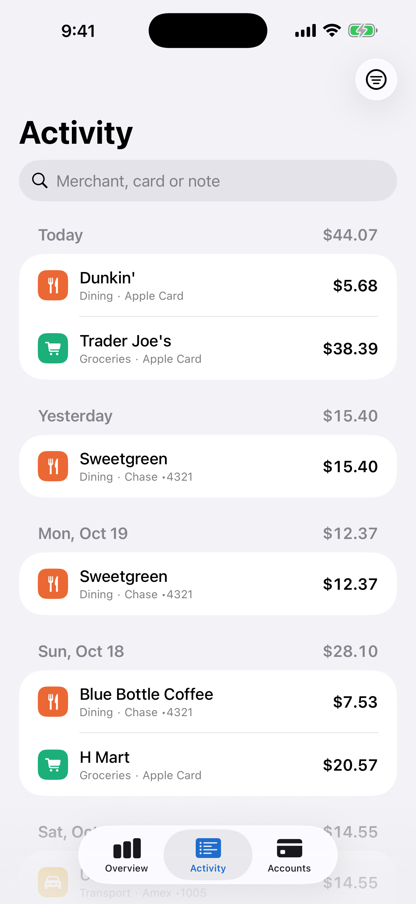
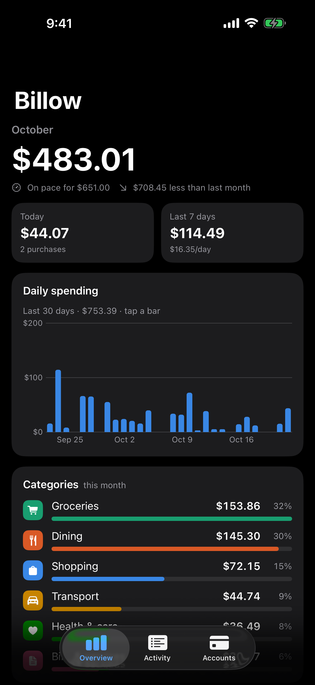

# Billow (iOS)

Automatic credit-card expense tracking. Native SwiftUI app; **no server**.
Every user connects their banks through **their own free Plaid account**
(bring-your-own-keys), so it costs $0 for you and for them, with no cap on
how many people use the app.


<p>
  
  
  
</p>
<sub>Simulator captures from CI (demo data). Re-run them: Actions → iOS → Run workflow → tick “screenshots”.</sub>

```
 Bank / card issuer ──▶ Plaid (user's own free Trial: 10 bank logins)
                              │  HTTPS, user's keys from the iOS Keychain
                              ▼
   Billow app on iPhone ── SwiftData store (on device only)
        ▲                      ├─ background refresh → "$4.75 · Blue Bottle" notifications
        │                      └─ dashboard · categories · cards · search
 Apple Pay tap ──▶ Shortcuts "Transaction" automation ──▶ Log Card Tap intent
                  (the only automatic path for Apple Card; merged with bank data)
```

The only thing you host is a tiny static site (`site/`) on Cloudflare Pages:
the `apple-app-site-association` file Plaid's OAuth requires, the OAuth
landing page, the privacy policy and a user setup guide.

## Repo layout

| Path | What |
|---|---|
| `project.yml` | XcodeGen spec — the `.xcodeproj` is generated (CI does it) |
| `Billow/` | App source: `Plaid/` (REST client + LinkKit 7), `Sync/`, `Model/`, `Views/`, `Intents/` |
| `.github/workflows/ios.yml` | Compiles every push; manual run signs + uploads to TestFlight |
| `scripts/signing.sh` | Make signing cert + set GitHub secrets from Windows |
| `site/` | Static site for Cloudflare Pages |

## One-time developer setup (no Mac needed)

### 1. Apple Developer portal (developer.apple.com → Certificates, IDs & Profiles)

1. **Identifiers → +** → App ID `com.houchenli.billow` (or change it in
   `project.yml` + `site/.well-known/apple-app-site-association` first).
   Enable **Associated Domains**.
2. In Git Bash: `scripts/signing.sh csr you@example.com "Your Name"` →
   **Certificates → +** → *Apple Distribution* → upload `signing/dist.csr` →
   download `distribution.cer`.
3. **Profiles → +** → *App Store Connect* → pick the App ID + certificate →
   name it e.g. `Billow App Store` → download the `.mobileprovision`.
4. Note your **Team ID** (Membership details).

### 2. App Store Connect (appstoreconnect.apple.com)

1. **Apps → + New App** → iOS, name *Billow*, bundle ID from step 1.
   Category: **Finance**.
2. **Users and Access → Integrations → App Store Connect API → Team Keys → +**
   (role *App Manager*) → download `AuthKey_XXXX.p8` (one chance!) and note
   the Key ID + Issuer ID.

### 3. GitHub secrets

```bash
scripts/signing.sh secrets distribution.cer Billow_App_Store.mobileprovision AuthKey_XXXX.p8 KEY_ID ISSUER_ID TEAM_ID
```

### 4. Static site (Cloudflare Pages, free)

The AASA file already contains Team ID AGBDAUWG94. Deploy with:

```bash
npx wrangler pages deploy site --project-name billow-app
```

If `billow-app` is taken, pick another name and update `BILLOW_LINK_DOMAIN`
in `project.yml` and the URLs in `site/index.html`.

### 5. Build → TestFlight

GitHub → **Actions → iOS → Run workflow**. About 15 minutes later the build
is in TestFlight; add yourself under **TestFlight → Internal Testing** and
install it from the TestFlight app. Internal testing (up to 100 people on
your team) needs no App Review. TestFlight builds expire after 90 days.

## End-user setup

Covered in-app (**Accounts → Plaid keys**) and at the site's home page:
free Plaid account → apply for the Trial plan → add the redirect URI → paste
`client_id` + secret → **Link a bank**.

## App Store submission notes

- Guideline 5.1.1(ix) says apps in highly regulated fields, such as banking,
  must come from a legal entity. Billow is a personal finance *viewer*: it
  moves no money, and the developer runs no servers and receives no user data.
  Suggested review note: *"Billow is a read-only spending tracker. It has no
  backend; each user connects their own Plaid developer account and all data
  stays on device. Demo data: Accounts → Demo data. Sandbox keys for bank
  linking: [client_id] / [sandbox secret], institution 'First Platypus Bank',
  user_good / pass_good."* If it is still rejected under 5.1.1(ix), the fix is
  an organization developer account (which also unlocks FinanceKit for Apple
  Card).
- Privacy label: **Data Not Collected** (nothing reaches the developer).
- Privacy policy URL: `https://billow-app.pages.dev/privacy` (fill in the
  contact line first).

## Limits, honestly

- Each user does a ~10-minute Plaid signup and the Trial needs approval; Plaid
  doesn't address personal-use accounts explicitly.
- No server means no webhooks: new charges arrive when the app opens, on
  pull-to-refresh (which also asks Plaid to re-check the bank), and on iOS
  background refresh (iOS decides when, typically every few hours).
- Plaid can't read Apple Card; the Apple Pay automation fills that gap for
  in-store taps only.
